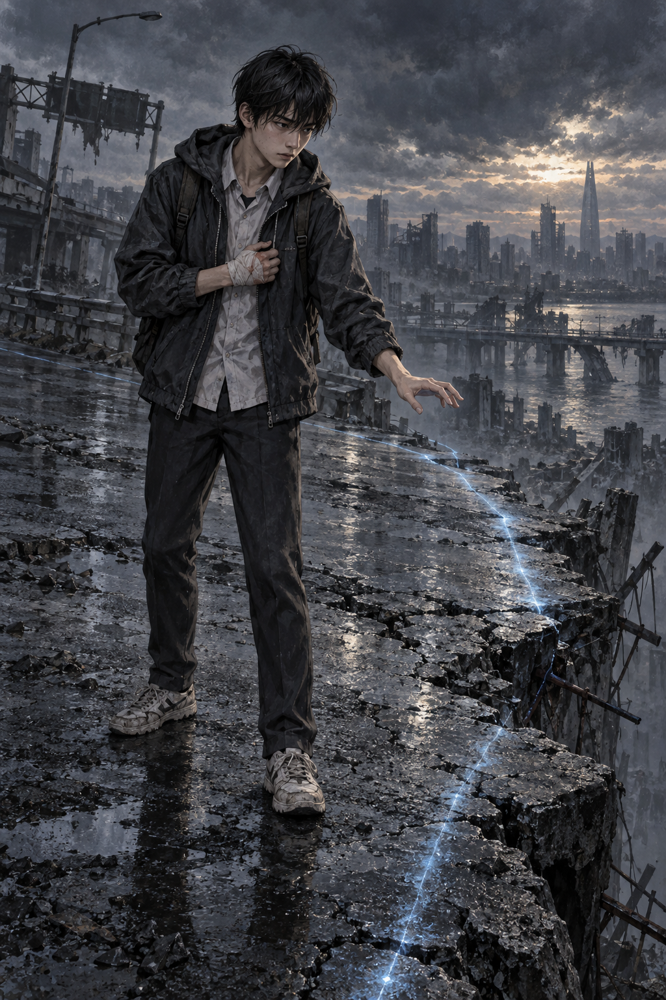
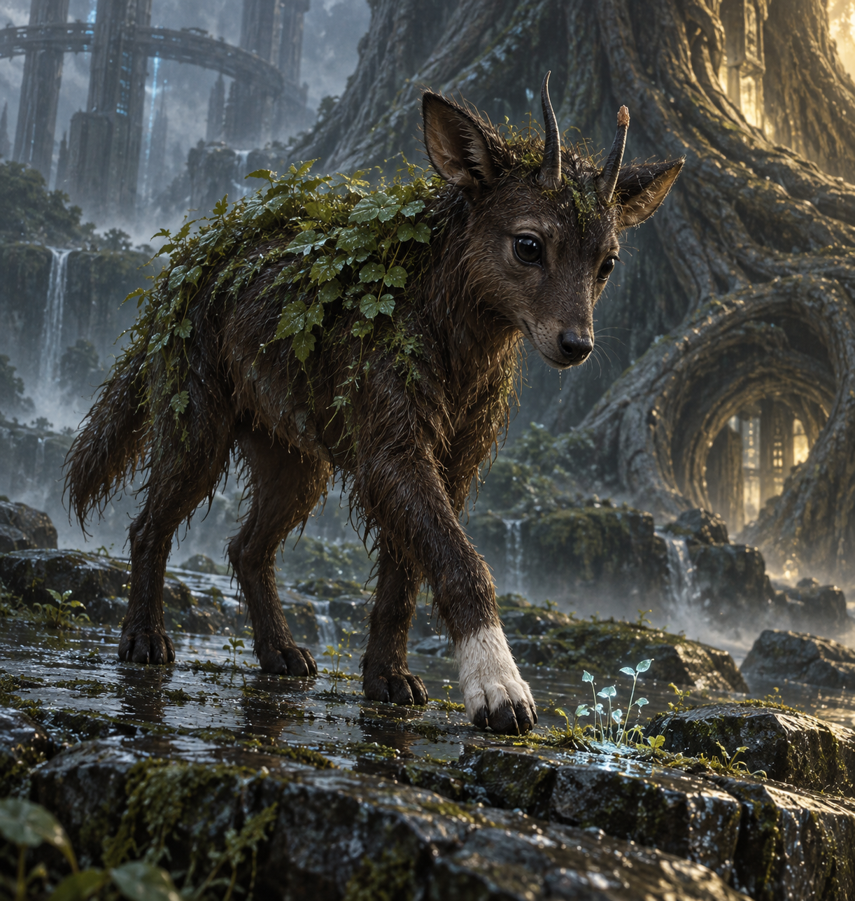
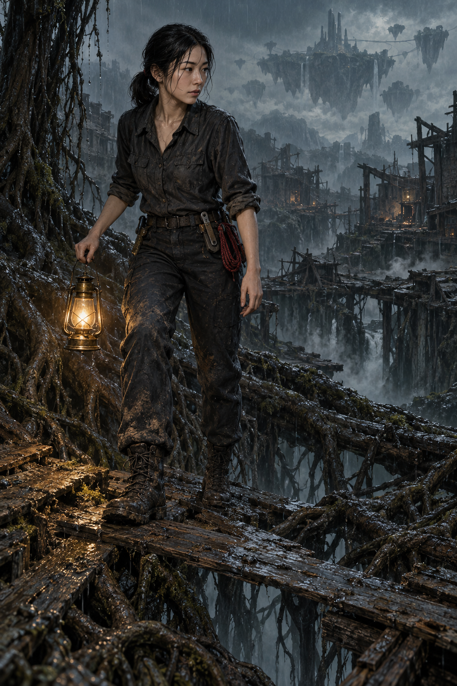
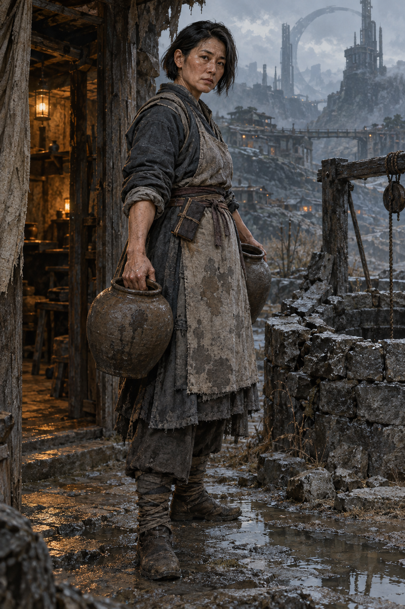
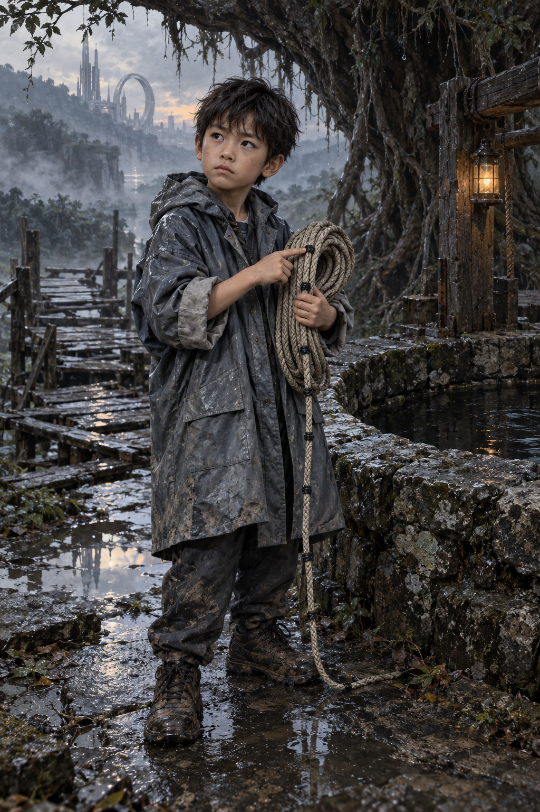
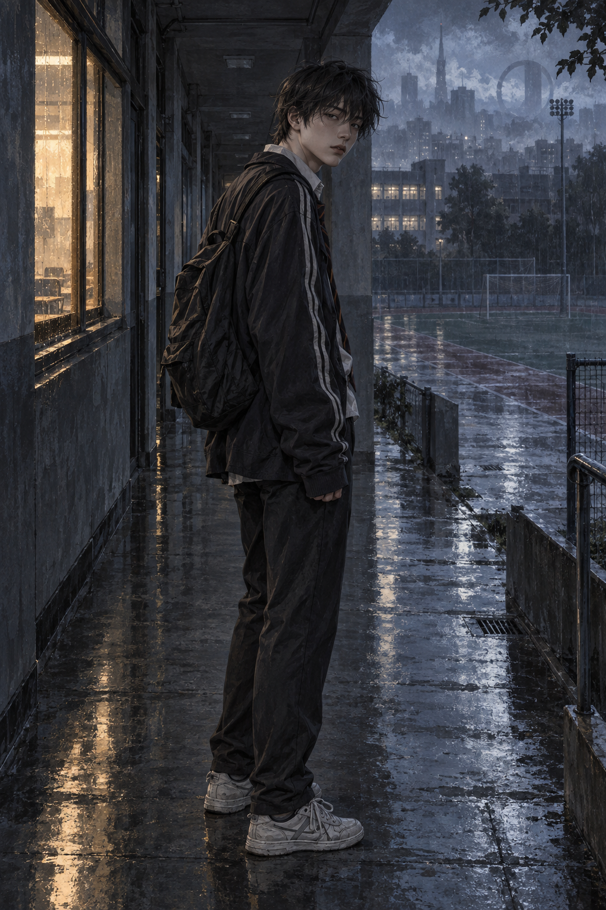
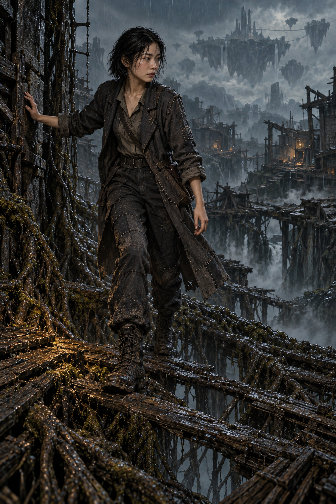
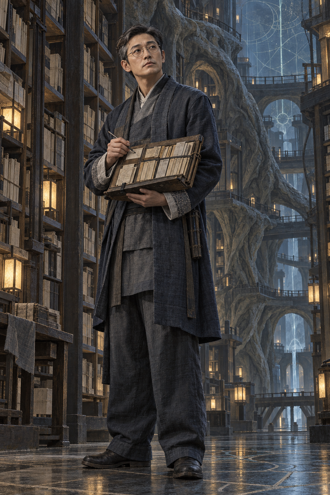
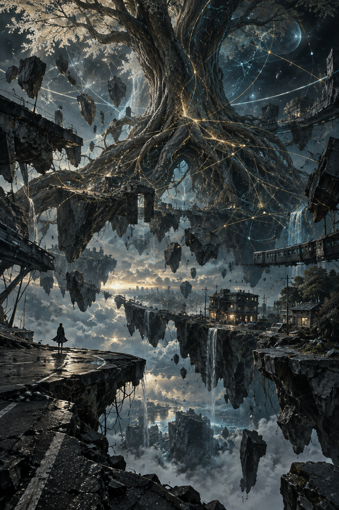
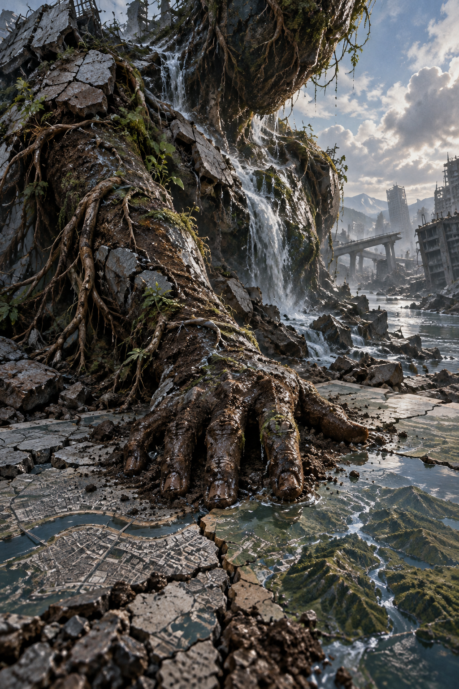

# THE ROOT — 인물 시각 바이블

이 그림들은 소설의 **시각 초안**이다. 얼굴, 머리 모양, 옷의 질감, 몸의 자세를 묘사할 때 확인한다. 그림에 없는 장면 소품까지 삭제하거나, 그림의 배경을 소설의 확정 설정으로 삼지는 않는다. 첫 등장에는 눈에 들어올 만한 특징 두세 가지를 중심으로 얼굴과 인상, 행동, 첫 대사가 연결되게 쓴다. 묘사를 두세 문장으로 제한하지 않으며, 인물을 알아보는 데 필요한 모습은 충분히 보여 준다. 인물의 과거와 말투는 [인물·목소리 바이블](10_THE_ROOT_인물_목소리_바이블.md)을 따른다.

## 초반에 등장하는 인물

### 이연우

열일곱 살. 마른 어깨에 검은 바람막이를 걸쳤고 안쪽의 옅은 색 교복 셔츠가 보인다. 앞머리는 비에 젖어 이마에 붙었다. 한쪽 손바닥에는 도로에서 다친 흔적이 있다. 남을 마주할 때는 그 손을 숨길 수 있지만, 처음 깨어난 장면에서는 빗물에 젖은 소매와 운동화처럼 당장 눈에 들어오는 것부터 쓴다.

### 흰다리

집필 기준으로 생후 약 2년인 어린 성체다. 연우는 정확한 나이를 모른다.

개만 한 네발짐승. 진갈색의 젖은 털 사이로 등에 작은 잎이 돋아 있고, 이마에 가느다란 뿔 두 개가 있다. **흰다리는 왼쪽 앞발 하나만** 발목까지 희다. 오른쪽 앞발과 두 뒷발은 모두 진갈색이다. 그림에서는 화면의 좌우가 아니라 짐승의 해부학적 좌우를 기준으로 확인한다. 검고 큰 눈과 흰 발은 멀리서도 알아볼 수 있는 표지다. 잎을 단순히 몸에 붙은 이끼라고 단정하지 않는다. 1화에서는 그렇게 잘못 보였다가 2화에 손으로 만져 확인한다.

### 서린

29세. 초반에는 연우가 20대 후반으로 짐작한다.

키가 크고, 검은 머리를 **뒤통수 아래에 하나로 묶었다**. 비에 젖은 옆머리 몇 가닥은 뺨에 붙어 있다. 짙은 작업 셔츠의 소매를 팔꿈치까지 접었고 바지와 장화에는 진흙이 묻었다. 허리의 노란 실은 길을 보수하는 사람의 물건이다. 초상에는 등불을 들었지만, 4화 장면에서는 놋그릇도 갖고 있다. 두 소품을 한 손에 동시에 쥐게 하지 않는다.

**묘사할 때:** “젖은 머리를 목덜미에 묶었다”처럼 젖은 정도와 묶은 위치를 한 덩어리로 쓰지 않는다. 머리가 어디서 어떻게 묶였는지, 풀린 머리카락이 어디에 붙었는지를 따로 보여 준다.

### 은솔

35세. 초반에는 연우가 30대 중반으로 짐작한다.

턱선까지 오는 검은 머리를 한쪽 귀 뒤로 넘겼다. 소매를 걷은 작업복 위에 물 얼룩이 겹친 앞치마를 둘렀고, 항아리를 쥐는 손마디가 굵다. 허리춤에는 물의 양과 배분을 적는 작은 수첩을 꽂고 다닌다. 항아리의 무게와 그릇 바닥에 남은 물을 먼저 보는 행동에, 연우를 살피는 표정을 함께 보여 준다.

### 마루

9세. 체격과 얼굴에서 연우보다 훨씬 어린 아이임이 드러난다. 연우는 마루에게 반말하고, 마루는 연우를 ‘형’이라 부른다.

헝클어진 짧은 머리, 몸에 큰 회색 우비, 접어 올린 소매, 진흙 묻은 장화가 보인다. 두 팔에는 검은 실로 수위를 표시한 밧줄을 감아 들었다. 말하면서 매듭을 손끝으로 짚는 모습이 중요한 표지다. 어린애처럼 굴게 하기보다 자기가 잰 숫자를 무시당하지 않으려는 표정을 쓴다.

## 뒤에 본격적으로 등장하는 인물 — 집필자용, 관계의 비밀 포함

### 민재

17세. 연우와 동갑이다.

연우와 같은 나이의 학생. 어두운 체육복 겉옷과 옅은 색 셔츠, 오래 신은 흰 운동화, 어깨의 가방이 보인다. 손을 소매 안에 가두듯 쥐고 있지만, 이 자세를 약물 경험의 전형처럼 쓰지 않는다. 연우가 기억하는 예전의 가벼운 몸짓과 현재의 경계하는 태도 사이의 차이를 장면에서 만든다.

### 산란

26세. 나이와 자매 관계는 집필용 설정이며, 초반 원고에서 혈연을 확정하는 설명으로 사용하지 않는다.

턱선에서 끊긴 검은 머리, 수선 자국을 밖으로 드러낸 어두운 겉옷, 길을 시험하듯 벽에 댄 손이 보인다. 서린과 얼굴의 선은 닮았지만 머리 길이와 옷을 고치는 방식이 다르다. **자매라는 사실을 일찍 확정하는 묘사는 금지한다.** 서린과 같은 손버릇은 후반의 단서로 남긴다.

### 해담

46세. 40대 중반의 성인이다.

둥근 안경, 여러 겹의 짙은 푸른색 기록관 복장, 정돈된 종이와 필기도구가 보인다. 기록판의 빈칸을 먼저 보는 시선과 작고 촘촘한 글씨가 인물의 통제 욕구를 드러낸다. 근엄한 관료의 외양만으로 악역이라 단정하지 않는다.

### THE ROOT

인간의 나이로 산정할 수 없다.

갈라진 세계를 관통하는 거대한 뿌리와 금빛·하늘색 관계의 선을 그린 **한 가지 현현**이다. 이 이미지가 THE ROOT의 고정된 몸이나 얼굴은 아니다. 초반에는 연우에게만 보이는 스크린과 목소리로 남긴다. 모습을 쓸 때는 인물 크기의 얼굴보다, 세계의 사물들이 한 뿌리로 연결되는 감각을 참고한다.

### 가이아

인간의 나이로 산정할 수 없다.

흙, 돌, 물, 뿌리가 거대한 손처럼 잠시 뭉친 **한 가지 현현**이다. 여성의 고정된 형상으로 확정하지 않는다. THE ROOT의 빛나는 선과 달리 실제로 닿고 무게가 실리는 지구의 물질을 참고한다.
